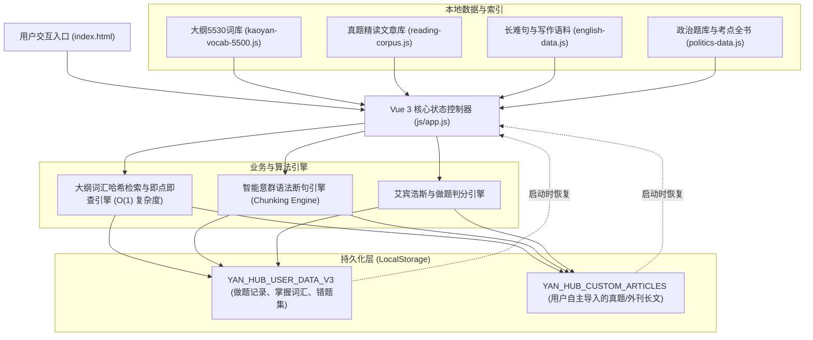

# 研途宝 (YanHub) · 系统架构与技术实现文档

本文档全面梳理研途宝备考平台的软件架构设计、技术选型原则、数据流转机制及前端核心逻辑。

---

## 🏗️ 整体设计原则

1. **零构建环境依赖 (Zero Build Setup)**
   - 采用纯静态架构，不依赖复杂的 Webpack/Vite 前置构建打包链路。
   - 使用 CDN 加载 Tailwind CSS 与 Vue 3 全局运行时，开箱即用，代码所见即所得。
2. **离线高可用与秒级响应 (Offline First & High Performance)**
   - 所有真题数据、考点全书与 5,530 大纲词库均以标准 JavaScript 文件离线存储。
   - 首次加载后无须联网即可离线运行，不受网络波动或后端服务器瘫痪影响。
3. **多端自适应 (Full Responsiveness)**
   - 针对 PC 宽屏、iPad 平板与手机移动端纵向屏幕做了深度自适应与触控优化。

---

## 📐 技术栈一览

| 模块 | 技术选型 | 说明 |
| :--- | :--- | :--- |
| **视图层框架** | Vue 3 (Composition API) | 响应式状态驱动、组件轻量化、DOM 高效更新 |
| **样式与布局** | Tailwind CSS 3.x (CDN) | 现代化实用类样式系统、Flex/Grid 弹性网格、移动端断点 |
| **字体与渲染** | Google Fonts (Inter + Merriweather) | 界面现代无衬线体 + 真题阅读沉浸式衬线体排版 |
| **真人语音朗读** | Web Speech API (`SpeechSynthesis`) | 浏览器原生美音发音，不消耗第三方付费 TTS 额度 |
| **本地数据持久化** | HTML5 `localStorage` | 自动持久化打卡记录、背词进度、错题本与生词本 |
| **静态托管与自动化** | GitHub Pages + GitHub Actions | 每次 `git push` 自动触发全量公网部署 |

---

## 🔄 核心模块数据流架构

---

## 🧩 核心功能实现原理

### 1. 考研大纲 5,530 词汇即点即查引擎 (O(1) 检索)
- 在系统初始化时，`buildVocabIndex()` 会将 5,530 个词汇构建为一个 `Map` 哈希索引。
- 当用户在阅读文章时点击任何单词（如 `reassessing`），分词正则会提取纯字母词根，尝试匹配原型及常见的规则变形（`-ing`, `-ed`, `-s` 等），在 1 毫秒内即可调出该词的大纲词频、真题考查次数与中文释义。

### 2. 智能意群语法断句算法 (Sentence Chunking)
- 许多考生面对 40~50 词的长难句往往产生读后忘前的问题。系统内置的断句正则引擎会在：
  - 逗号、分号、破折号、冒号处添加断句标记；
  - 宾语从句、定语从句及状语从句引导词（`that`, `which`, `who`, `where`, `when`, `because`, `although` 等）前自动插入断点；
  - 核心固定搭配短语（`in the wake of`, `according to` 等）前后切分意群；
- 切分后以 `[ 意群 ] / [ 意群 ]` 格式渲染为高亮阅读色块，训练考生快速抓取主谓宾与从句修饰层级的断句思维。

### 3. 自定义考研文章导入工坊
- 允许用户无缝导入任何考研试卷（2000-2024 年）或外刊文本。
- 系统使用两段换行符 `\n\s*\n` 自动拆分自然段，自动运行分词分析，计算考研大纲词汇覆盖率，并永久保存在本地 `localStorage`，实现文章库的无上限扩充。
